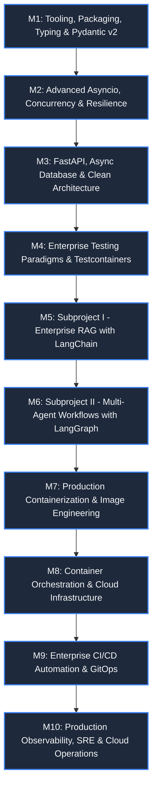

# Production-Grade Python Engineering: Cloud-Native Systems Roadmap

> **Target Audience:** Mid, Senior, and Staff-level Engineers transitioning to or mastering modern, production-grade Python (3.12+) architectures for scalable, high-throughput cloud environments (AWS & GCP).
>
> **Core Architectural Paradigm:** Single Unified Production Repository. Every module builds an integral, production-grade layer within `src/cloud_platform/`, culminating in a complete, deployable cloud-native enterprise system with AI capabilities.

---

## 1. The Business Problem & Product Vision (*NexusOps*)

### The Problem: Enterprise Cloud Downtime & High MTTR
In modern cloud-native architectures across AWS and GCP, production downtime costs enterprises between **\$5,000 and \$50,000+ per minute**. During a Severity-1 incident:
- **Alert Fatigue & Fragmented Context:** On-call engineers are inundated with cascading alerts and spend 15–30 minutes manually sifting through scattered runbooks, architecture wikis, and historical post-mortems.
- **The Hazard of Unguarded Automation:** Unsupervised automation scripts risk compounding outages (e.g. terminating the wrong cluster or corrupting database state).
- **Multi-Tenant Compliance & Auditability:** Enterprise clients require strict tenant isolation, immutable audit logging, and guaranteed SLA tiers.

### The Solution: *NexusOps* (Autonomous Incident Reliability & Runbook Copilot)
A high-throughput, multi-tenant cloud platform that:
1. Ingests high-velocity telemetry alerts with bounded concurrency and backpressure.
2. Semantically retrieves relevant internal runbooks and historical fixes via **LangChain + PostgreSQL `pgvector`** with real-time SSE streaming.
3. Diagnoses root causes and drafts remediation plans using a **LangGraph stateful multi-agent system**.
4. Enforces a **Human-in-the-Loop (HITL) approval gate** before applying any infrastructure remediation.
5. Operates in production-hardened containers across AWS and GCP with full OpenTelemetry tracing, Prometheus RED metrics, and zero-downtime CI/CD.

### Business Value Metrics (KPIs)
- **MTTR (Mean Time to Resolution):** Reduced by 60–75%.
- **Mean Time to Context:** Reduced from 15–30 minutes to <3 seconds.
- **Remediation Safety:** 100% human-verified operational changes with immutable audit logging.

---

## 2. Architectural Philosophy & Foundations

Python has evolved from a scripting language into a premier choice for high-performance backend microservices, asynchronous data streaming, and production AI orchestration. Building enterprise-grade Python systems requires strict architectural discipline:

- **Single Cohesive Codebase:** Instead of fragmented mini-projects, all components integrate into a unified enterprise platform (`cloud_platform`), reflecting how real production codebases are structured and maintained.
- **Type Safety as a Contract:** Strict static typing with Mypy/Pyright is non-negotiable. Types are not decorative; they are compile-time safety nets and machine-readable contracts.
- **Modern Packaging & Tooling:** Eliminating slow, legacy dependency managers in favor of blazing-fast Rust-powered tooling (`uv`, `ruff`).
- **Structured Asynchronous Concurrency:** Replacing unconstrained threading or raw event loops with structured concurrency (`asyncio.TaskGroup`), bounded memory queues, and backpressure.
- **Clean Architecture & Separation of Concerns:** Domain logic completely decoupled from database models, web frameworks, and external cloud services.
- **Realistic, Isolated Testing:** Moving away from brittle mock-everything approaches toward contract testing, property-based testing (`Hypothesis`), and ephemeral real service testing (`testcontainers`).
- **Reliable AI Engineering:** Transitioning from unstructured prompt-tweaking to deterministic, stateful graph-based agents (`LangGraph`) and production RAG pipelines (`LangChain`) with tracing, evaluations, and human-in-the-loop oversight.
- **Container & Image Engineering:** Crafting minimal, non-root, cache-optimized multi-stage Docker images (<120MB) with strict signal propagation (PID 1).
- **Cloud Orchestration & IaC:** Provisioning reproducible cloud environments via Terraform across AWS (ECS Fargate, Aurora) and GCP (Cloud Run, Cloud SQL) with Kubernetes primitives.
- **Automated Delivery & Release Engineering:** Zero-downtime releases (Canary / Blue-Green), automated semantic versioning, private artifact indices, and ephemeral migration gates.
- **Deep Production Observability & SRE:** End-to-end distributed tracing (OpenTelemetry), structured JSON logging (`structlog`), RED metrics (Prometheus), and SLO-driven alerting.

---

## 2. Technology & Tooling Matrix

| Domain | Technology / Tool | Role in Modern Production Stack |
| :--- | :--- | :--- |
| **Package & Project Management** | `uv`, `pip`, `pyproject.toml` | Blazing-fast virtualenvs, strict cross-platform lockfiles, PEP 517/621 packaging. |
| **Code Quality & Static Analysis**| `ruff`, `mypy`, `pyright` | Unified sub-second linter/formatter; strict type checking with Generics and Protocols. |
| **Validation & Schema Management**| `pydantic v2`, `pydantic-settings` | High-performance C/Rust-backed serialization, validation, and 12-factor configuration. |
| **Concurrency & Async Runtime** | `asyncio`, `uvloop` | Single-threaded cooperative multitasking, structured concurrency, async worker pools. |
| **Web API Framework** | `FastAPI`, `Starlette`, `granian` / `uvicorn` | High-throughput asynchronous REST/WebSocket APIs with automatic OpenAPI schema generation. |
| **Persistence & Database** | `PostgreSQL`, `asyncpg`, `SQLAlchemy 2.0` | Production async relational persistence, DeclarativeBase, Unit of Work, connection pooling. |
| **Schema Migrations** | `Alembic` | Version-controlled, zero-downtime database migrations (expand/contract patterns). |
| **Caching & Messaging** | `Redis` (`redis-py` async) | In-memory distributed caching, rate-limiting, and lightweight pub/sub. |
| **Testing Framework** | `pytest`, `pytest-asyncio`, `pytest-mock` | Fixture-based testing framework with strict async lifecycle management. |
| **Integration Testing** | `testcontainers-python` | Ephemeral Docker containers for true integration tests (Postgres, Redis, LocalStack). |
| **Generative Testing** | `Hypothesis` | Property-based testing to uncover edge cases and state machine invalidations. |
| **AI - RAG & Chains** | `LangChain`, `pgvector` | Retrieval Augmented Generation (RAG), vector embeddings, semantic hybrid search. |
| **AI - Multi-Agent Workflows** | `LangGraph`, `LangSmith` | Cyclic, stateful multi-agent orchestration, checkpoint persistence, human-in-the-loop gates. |
| **Container & Image Engineering** | `Docker`, `BuildKit`, Google Distroless | Multi-stage builds, non-root security, BuildKit cache mounts, PID 1 init (`tini`). |
| **Security & Vulnerability** | `trivy`, `syft`, `cosign` | CVE vulnerability scanning, Software Bill of Materials (SBOM), container image signing. |
| **Orchestration & Compute** | `Kubernetes`, `AWS ECS Fargate`, `GCP Cloud Run` | Pods/Deployments, serverless containers, rolling updates, HPA auto-scaling. |
| **Infrastructure as Code (IaC)** | `Terraform` / `OpenTofu` | Declarative cloud provisioning (VPC, RDS Aurora, Cloud SQL, IAM least privilege). |
| **CI/CD & Release Engineering** | `GitHub Actions`, `commitizen`, `ArgoCD` | Multi-job matrix pipelines, semantic versioning, private registries, GitOps. |
| **Observability & SRE** | `OpenTelemetry`, `structlog`, `Prometheus`, `Grafana` | Distributed tracing, structured JSON logging, RED metrics, SLI/SLO error budgets. |

---

## 3. Ten-Module Progressive Curriculum

---

### Module 01: Modern Python Tooling, Packaging, Typing & Pydantic v2
- **Guide:** [`docs/modules/01_tooling_typing_pydantic.md`](docs/modules/01_tooling_typing_pydantic.md)
- **Codebase Integration:** `pyproject.toml`, `src/cloud_platform/core/config.py`, `src/cloud_platform/core/protocols.py`, `src/cloud_platform/core/decorators.py`, `src/cloud_platform/domain/models.py`.
- **Engineering Deliverables:** Universal `uv` lockfile, strict Mypy/Pyright checks with `Protocol` and `ParamSpec`, Pydantic v2 settings management and validation engine.

### Module 02: Advanced Concurrency, Asyncio & Production Resilience
- **Guide:** [`docs/modules/02_asyncio_concurrency_resilience.md`](docs/modules/02_asyncio_concurrency_resilience.md)
- **Codebase Integration:** `src/cloud_platform/core/concurrency.py`, `src/cloud_platform/core/resilience/`
- **Engineering Deliverables:** `asyncio.TaskGroup` structured concurrency, producer-consumer queues with bounded backpressure, circuit breaker state machine, `tenacity` jitter retries, and graceful `SIGTERM` draining.

### Module 03: Enterprise REST APIs with FastAPI, Async Databases & Clean Architecture
- **Guide:** [`docs/modules/03_fastapi_database_clean_architecture.md`](docs/modules/03_fastapi_database_clean_architecture.md)
- **Codebase Integration:** `src/cloud_platform/api/`, `src/cloud_platform/infrastructure/database/`, `src/cloud_platform/infrastructure/cache/`, `migrations/`
- **Engineering Deliverables:** Hexagonal / Clean Architecture, FastAPI with DI trees & middleware pipelines, async PostgreSQL with `SQLAlchemy 2.0` & `asyncpg`, zero-downtime `Alembic` migrations, and Redis caching.

### Module 04: Enterprise Testing Paradigms: From Unit to Testcontainers & Property Testing
- **Guide:** [`docs/modules/04_testing_paradigms_testcontainers.md`](docs/modules/04_testing_paradigms_testcontainers.md)
- **Codebase Integration:** `tests/unit/`, `tests/property/`, `tests/integration/`
- **Engineering Deliverables:** Pytest async fixtures, ephemeral Docker containers for Postgres and Redis via `testcontainers-python`, property-based tests with `Hypothesis`, and mutation test verification.

### Module 05: Subproject I — Enterprise RAG Service with LangChain & Vector Search
- **Guide:** [`docs/modules/05_langchain_enterprise_rag.md`](docs/modules/05_langchain_enterprise_rag.md)
- **Codebase Integration:** `src/cloud_platform/ai/rag/`
- **Engineering Deliverables:** Production RAG pipeline using LangChain Expression Language (LCEL), PostgreSQL `pgvector` hybrid search (dense semantic + sparse keyword), FastAPI Server-Sent Events (SSE) streaming API, and RAGAS evaluation harness.

### Module 06: Subproject II — Autonomous Multi-Agent Workflows with LangGraph
- **Guide:** [`docs/modules/06_langgraph_multiagent_workflows.md`](docs/modules/06_langgraph_multiagent_workflows.md)
- **Codebase Integration:** `src/cloud_platform/ai/agents/`
- **Engineering Deliverables:** Cyclic multi-agent graph with Pydantic state, PostgreSQL checkpoint persistence (`PostgresSaver`), time-travel execution replay, and Human-in-the-Loop (HITL) approval gates.

### Module 07: Production Containerization & Image Engineering
- **Guide:** [`docs/modules/07_production_containers_images.md`](docs/modules/07_production_containers_images.md)
- **Codebase Integration:** `docker/Dockerfile`, `docker/Dockerfile.distroless`, `docker/docker-compose.yml`
- **Engineering Deliverables:** Multi-stage Docker builds with BuildKit `uv` cache mounts, minimal Distroless runtime (<120MB), non-root execution (`USER 10001`), PID 1 init (`tini`), and `trivy` CVE scanning.

### Module 08: Container Orchestration & Cloud Infrastructure
- **Guide:** [`docs/modules/08_orchestration_cloud_infrastructure.md`](docs/modules/08_orchestration_cloud_infrastructure.md)
- **Codebase Integration:** `k8s/`, `terraform/aws/`, `terraform/gcp/`
- **Engineering Deliverables:** Production Kubernetes manifests (deployments, probes, HPA), Terraform modules provisioning AWS ECS Fargate + Aurora Serverless and GCP Cloud Run + Cloud SQL.

### Module 09: Enterprise CI/CD Automation, Release Engineering & GitOps
- **Guide:** [`docs/modules/09_cicd_release_engineering.md`](docs/modules/09_cicd_release_engineering.md)
- **Codebase Integration:** `.github/workflows/`
- **Engineering Deliverables:** Sub-2-minute GitHub Actions CI matrix, automated semantic versioning, private artifact wheel publishing, and zero-downtime Canary / Blue-Green rollout workflows.

### Module 10: Production Observability, SRE & Cloud Operations
- **Guide:** [`docs/modules/10_observability_sre_cloud_operations.md`](docs/modules/10_observability_sre_cloud_operations.md)
- **Codebase Integration:** `src/cloud_platform/observability/`, `monitoring/`
- **Engineering Deliverables:** OpenTelemetry distributed tracing across HTTP/DB/LLMs, high-performance structured JSON logging with `structlog`, Prometheus RED metrics, and Alertmanager SLO budget alerting.

---

## 4. Execution Workflow & Progress Tracker

| Module | Focus Area | Status | Target Deliverables in Unified Codebase |
| :---: | :--- | :---: | :--- |
| **01** | Tooling, Packaging, Typing, Pydantic v2 | In Progress | `pyproject.toml`, `core/config.py`, `core/protocols.py`, `domain/models.py` |
| **02** | Asyncio, Concurrency & Resilience | Pending | `core/concurrency.py`, `core/resilience/` (TaskGroups, queues, circuit breakers) |
| **03** | FastAPI, Async DB & Clean Architecture | Pending | `api/`, `infrastructure/database/`, `infrastructure/cache/`, `migrations/` |
| **04** | Testing Paradigms & Testcontainers | Pending | `tests/unit/`, `tests/property/`, `tests/integration/` (Testcontainers) |
| **05** | **Subproject 1:** Enterprise RAG (LangChain) | Pending | `ai/rag/` (LCEL pipeline, pgvector hybrid search, FastAPI SSE stream) |
| **06** | **Subproject 2:** Multi-Agent (LangGraph) | Pending | `ai/agents/` (StateGraph, PostgreSQL checkpointing, HITL approval gate) |
| **07** | Production Containers & Image Engineering | Pending | `docker/Dockerfile` (multi-stage, BuildKit uv cache, non-root Distroless) |
| **08** | Orchestration & Cloud Infrastructure | Pending | `k8s/` manifests, `terraform/aws/`, `terraform/gcp/` |
| **09** | CI/CD Automation & GitOps | Pending | `.github/workflows/` (cached CI, private artifact publishing, Canary rollouts) |
| **10** | Observability, SRE & Cloud Operations | Pending | `observability/` (OpenTelemetry traces, Prometheus RED metrics, `structlog`) |
